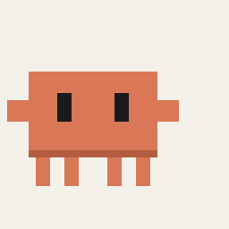
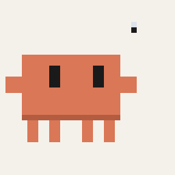
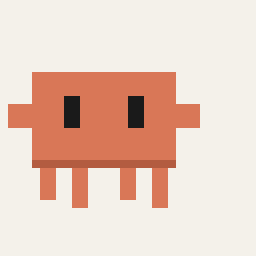

<div align="center">

# Pixel Studio

**Dibuja sprites en pixel art, anímalos cuadro a cuadro y mira a tu agente de IA dibujar a tu lado.**

[English](README.md) · **Español**


</div>

---

Este es el editor visual de Pixel Studio. Habla con [**pixel-studio-api**](https://github.com/FernandoMVG/pixel-studio-api), que guarda tus proyectos y expone los mismos comandos de dibujo a los agentes de IA por MCP. Cuando un agente dibuja, ves aparecer cada trazo en vivo.

<div align="center">





*Dibujadas y animadas por Claude a través de MCP, en este editor.*

</div>

## Funciones

- **Herramientas de dibujo:** lápiz, borrador, bote de pintura, cuentagotas, línea, rectángulo, selección y mover, espejo horizontal.
- **Animación:** varias animaciones por proyecto, línea de tiempo con miniaturas, papel cebolla y **duración por cuadro** para hacer pausas sin duplicar cuadros.
- **Vista previa en vivo** en el panel lateral y una **sala de proyección** a pantalla completa para ver la animación en grande.
- **Dibuja con tu agente:** los cambios que llegan por MCP aparecen en vivo, la pantalla *Agente* muestra lo que ha hecho y tú decides si puede crear o borrar proyectos.
- **Deshacer/rehacer** por autor: tu historial y el del agente no se pisan.
- **Exporta** a PNG, hoja de sprites, GIF animado, texto para agentes o el `.json` del proyecto. Siempre escalado con *nearest neighbor*.
- **Tema claro y oscuro**, inspirados en una mesa de luz.

## Inicio rápido

Necesitas la API en marcha. Clona los dos repos uno al lado del otro; el editor importa los tipos de la API desde `../pixel-api`:

```bash
git clone https://github.com/FernandoMVG/pixel-studio-api.git pixel-api
git clone https://github.com/FernandoMVG/pixel-studio-web.git pixel-web

cd pixel-api && npm install && npm run dev     # http://127.0.0.1:4317
cd ../pixel-web && npm install && npm run dev  # http://localhost:5173
```

Para apuntar el editor a otra dirección de la API, define `VITE_API_URL` (por defecto `http://127.0.0.1:4317`).

## Atajos de teclado

| Tecla | | Tecla | |
|---|---|---|---|
| `B` | Lápiz | `0`–`6` | Elegir color |
| `E` | Borrador | `#` | Cuadrícula |
| `G` | Relleno | `O` | Papel cebolla |
| `I` | Cuentagotas | `+` / `−` | Zoom |
| `L` | Línea | `Espacio` | Reproducir / pausar |
| `U` | Rectángulo | `,` / `.` | Cuadro anterior / siguiente |
| `M` | Selección | `Ctrl Z` | Deshacer |
| `H` | Espejo horizontal | `Ctrl Shift Z` | Rehacer |
| `Alt` + arrastrar | Copiar la selección | `?` | Todos los atajos |

## Cómo está hecho

- **Cliente ligero:** la lógica de dibujo vive en la API. El editor pinta localmente solo para responder al instante, envía los cambios en lotes y aplica los parches del servidor.
- **Organizado por funcionalidad:** `src/features/` (`projects`, `editor`, `agent`, `export`, `settings`, `search`), con el transporte en `src/infra/` y los componentes del sistema de diseño en `src/shared/`.
- **Tipos compartidos** directamente desde los esquemas Zod de la API, sin un tercer paquete en medio.

```bash
npm run build   # build de producción
```

## Licencia

[MIT](LICENSE)
