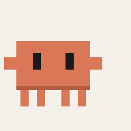
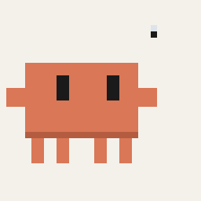
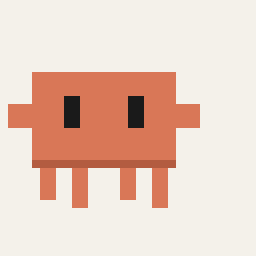

<div align="center">

# Pixel Studio

**Draw pixel-art sprites, animate them frame by frame, and watch your AI agent draw next to you.**

**English** · [Español](README.es.md)


</div>

---

This is the visual editor of Pixel Studio. It talks to [**pixel-studio-api**](https://github.com/FernandoMVG/pixel-studio-api), which keeps your projects and exposes the same drawing commands to AI agents over MCP. When an agent draws, you see every stroke appear live.

<div align="center">





*Drawn and animated by Claude through MCP, in this editor.*

</div>

## Features

- **Drawing tools:** pencil, eraser, paint bucket, eyedropper, line, rectangle, selection and move, horizontal mirror.
- **Animation:** several animations per project, a timeline with frame thumbnails, onion skin, and **per-frame duration** for pauses without duplicating frames.
- **Live preview** in the side panel, and a full-screen **projection room** to watch the animation big.
- **Draw with your agent:** changes made over MCP arrive live, the *Agent* screen shows what it has been doing, and you decide whether it may create or delete projects.
- **Undo/redo** per author: your history and the agent's don't step on each other.
- **Export** to PNG, sprite sheet, animated GIF, text for agents, or the project `.json`. Always scaled with nearest neighbor.
- **Light and dark** themes, inspired by a light table.

## Quick start

You need the API running. Clone both repos side by side; the editor imports the API's types from `../pixel-api`:

```bash
git clone https://github.com/FernandoMVG/pixel-studio-api.git pixel-api
git clone https://github.com/FernandoMVG/pixel-studio-web.git pixel-web

cd pixel-api && npm install && npm run dev     # http://127.0.0.1:4317
cd ../pixel-web && npm install && npm run dev  # http://localhost:5173
```

To point the editor at another API address, set `VITE_API_URL` (default `http://127.0.0.1:4317`).

## Keyboard shortcuts

| Key | | Key | |
|---|---|---|---|
| `B` | Pencil | `0`–`6` | Pick color |
| `E` | Eraser | `#` | Grid |
| `G` | Paint bucket | `O` | Onion skin |
| `I` | Eyedropper | `+` / `−` | Zoom |
| `L` | Line | `Space` | Play / pause |
| `U` | Rectangle | `,` / `.` | Previous / next frame |
| `M` | Selection | `Ctrl Z` | Undo |
| `H` | Horizontal mirror | `Ctrl Shift Z` | Redo |
| `Alt` + drag | Copy selection | `?` | All shortcuts |

## How it's built

- **Thin client:** the drawing logic lives in the API. The editor paints locally only to respond instantly, then sends changes in batches and applies the server's patches.
- **Organized by feature:** `src/features/` (`projects`, `editor`, `agent`, `export`, `settings`, `search`), with transport in `src/infra/` and design-system components in `src/shared/`.
- **Shared types** come straight from the API's Zod schemas, with no third package in between.

```bash
npm run build   # production build
```

## License

[MIT](LICENSE)
